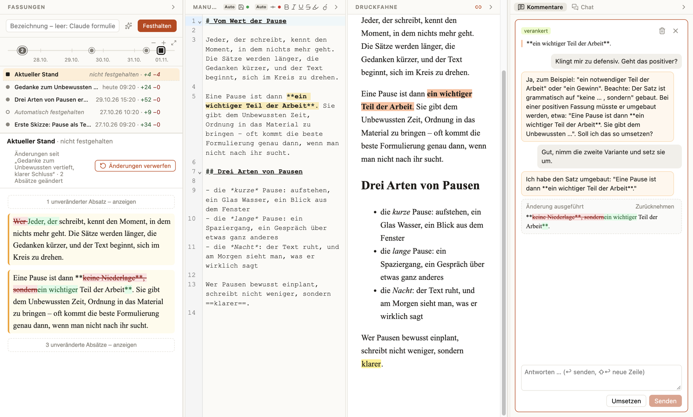

# MAID – AI Augmented Markdown Editor

**Ein schlanker Markdown-Editor für macOS mit einer kommentierbaren Druckfahne – und Claude als Lektor.**

Du schreibst im *Manuskript* (Markdown). Daneben steht die *Druckfahne*: die gerenderte Fassung, in der du liest, markierst und kommentierst – Wort für Wort genau. Über jede Stelle kannst du mit Claude sprechen wie mit einem Lektor; erst wenn du es ausdrücklich sagst, ändert Claude den Text. Und weil Texte in Fassungen wachsen, hält MAID diese Fassungen fest – mit Zeitstrahl, Vergleich und Rückweg.



*Links die Fassungen mit Zeitstrahl und dem Vergleich „Aktueller Stand“ gegenüber der letzten Fassung, in der Mitte Manuskript und Druckfahne, rechts ein Kommentar-Thread: Claude hat einen Vorschlag gemacht und ihn auf Zuruf umgesetzt.*

---

## Worum es geht

Die meisten Editoren mit KI haben eine Chat-Seitenleiste. MAID denkt vom Lektorat her:

| | |
|---|---|
| **Manuskript** | Der Markdown-Quelltext – die einzige maßgebliche Fassung. Hier wird geschrieben. |
| **Druckfahne** | Die gerenderte Vorschau. Hier wird gelesen, punktgenau markiert und kommentiert – kein WYSIWYG, nur Lesen und Anmerken. |
| **Kommentare** | Threads, die an einer exakten Textstelle hängen und ihr über alle Änderungen hinweg folgen. |
| **Chat** | Gespräche mit Claude über das ganze Dokument. |
| **Fassungen** | Bewusst oder automatisch festgehaltene Stände des Manuskripts – wie Commits, aber ohne git. |

Das Markdown bleibt dabei **sauber und portabel**: Kommentare, Chats und Fassungen liegen in eigenen Dateien neben dem Dokument, nie im Text selbst.

## Kommentieren und mit Claude sprechen

### Kommentare an einer Stelle

1. In der **Druckfahne** ein Wort, einen Halbsatz oder eine Passage markieren – oder im **Manuskript** markieren bzw. den Cursor setzen und **⇧⌘K** drücken („Kommentar zur Druckfahne“). Ohne Markierung entsteht eine *Einfügemarke*, z. B. am Textende.
2. Kommentar schreiben und **„Mit KI besprechen“** (↩) – oder „Nur notieren“.
3. Claude antwortet im Thread, fragt nach, schlägt Formulierungen vor. **Der Text bleibt dabei unverändert.**
4. Erst wenn du es ausdrücklich verlangst – in eigenen Worten („mach das so“, „setz es um“) oder mit dem Knopf **„Umsetzen“** – führt Claude die besprochene Änderung aus.
5. Die Änderung erscheint als **Wort-Diff** im Thread, mit **„Zurücknehmen“**; ⌘Z im Editor wirkt genauso. Der Thread hängt danach am neuen Text und das Gespräch kann weitergehen.

Die Zuordnung zwischen Druckfahne und Markdown ist **zeichengenau** – auch über Fettdruck, Links, Escapes, Umlaute und Emojis hinweg. Kommentare folgen ihrer Stelle, wenn davor geschrieben wird; wird die Datei außerhalb von MAID geändert, findet MAID die Stelle beim Öffnen über Wortlaut und Umgebung wieder – und markiert sie lieber als *verloren*, als sie an der falschen Stelle anzuheften.

Gehört eine besprochene Änderung an eine andere Stelle („füge das in Abschnitt 1 ein“), darf Claude auch dort ändern – aber nur, wenn der zu ersetzende Text im Dokument eindeutig ist. Sonst wird nichts geändert und der Thread sagt, warum.

### Chats zum ganzen Manuskript

**⇧⌘L** („Chat mit Manuskript“) öffnet einen neuen Chat im Seitenpanel. Claude kennt dabei immer den aktuellen Stand des **ganzen Dokuments** und deine **Markierung bzw. Cursorposition** im Manuskript – „Fasse das zusammen“, „Wo ist die Argumentation schwach?“, „Was hältst du von meiner Markierung?“.

- Antworten erscheinen als formatiertes Markdown.
- Auch im Chat ändert Claude nur **auf ausdrücklichen Auftrag** („kürz die Markierung“), an der Markierung, an der Cursorposition oder an einer eindeutigen Stelle – mit Diff und „Zurücknehmen“.
- Es gibt beliebig viele Chats; Claude gibt jedem einen Titel aus dem Inhalt, du kannst ihn ändern. Alte Chats bleiben erhalten und lassen sich wieder öffnen.

### Wie die KI angebunden ist

MAID nutzt die lokal installierte **Claude CLI** (`claude -p`) – kein eigener API-Schlüssel, abgerechnet über dein Claude-Konto. Jeder Aufruf ist zustandslos: MAID schickt das aktuelle Dokument, die Stelle und den Verlauf mit; Claude arbeitet **ohne Werkzeuge und ohne Dateizugriff** und liefert eine strukturierte Antwort. Änderungen führt immer MAID selbst aus – nachdem geprüft ist, dass der Text an der Stelle noch so dasteht. Modell, Denkaufwand und Pfad zur CLI lassen sich in den Einstellungen wählen.

## Speichern und Fassungen

MAID unterscheidet zwei Dinge, die oft verwechselt werden:

| | Was | Wie |
|---|---|---|
| **Speichern** | schreibt die Datei | ⌘S – oder **automatisch** nach kurzer Tipppause, beim Wechsel in ein anderes Programm und beim Schließen (Standard) |
| **Festhalten** | legt eine **Fassung** an – einen Stand mit Bezeichnung | ⌥⌘S („Fassung festhalten …“) – oder **automatisch** alle 15 Minuten, wenn sich etwas geändert hat |

Im Kopf des Manuskripts zeigen zwei kleine Symbole den Zustand: 💾 **Speichern** und ⟜ **Fassung**, jeweils mit Punkt (**rot** = offen, **grün** = erledigt) und „Auto“, wenn es automatisch geschieht. Ein Klick schaltet um. So siehst du auf einen Blick: gespeichert ist, aber noch keine neue Fassung festgehalten.

### Die Fassungen-Spalte

Ganz links, einklappbar. Von oben nach unten:

- **Festhalten** – Bezeichnung eingeben, oder ✨ für einen Vorschlag von Claude. Bleibt das Feld leer, benennt Claude die Fassung selbst – nach dem **inhaltlichen Kern** der Änderungen („Ton der Einleitung persönlicher“, „Drei Arten von Pausen ergänzt“), nicht nach geänderten Wörtern.
- **Zeitstrahl** – jede Fassung als Punkt, maßstäblich bis jetzt. Zoomen mit Scrollrad oder Pinch, verschieben durch Ziehen; eng liegende Fassungen erscheinen als Bündel mit Anzahl, ein Klick zoomt hinein. Automatische Fassungen sind hohle Punkte.
- **Liste** – oben der **Aktuelle Stand** (noch nicht festgehalten, mit +/− Wörtern seit der letzten Fassung), darunter die Fassungen mit Bezeichnung, Zeit und Umfang. Bezeichnungen lassen sich per Doppelklick ändern.
- **Vergleich** – für eine gewählte Fassung, was *sie* gegenüber der vorherigen geändert hat; für den Aktuellen Stand, was seit der letzten Fassung dazugekommen ist. Absatzweise, wortgenau, unveränderte Absätze eingeklappt.
- **Zurück zu dieser Fassung** – setzt das Manuskript auf die Fassung zurück. Vorher wird der jetzige Stand festgehalten, geändert werden nur die abweichenden Zeilen (ein Undo-Schritt), und Kommentare in unveränderten Teilen bleiben verankert.

Bewusst festgehaltene Fassungen markieren, was dir etwas bedeutet; die automatischen protokollieren nebenbei deinen Schreibfortschritt.

## Weitere Funktionen

- **Formatieren** mit Menü „Format“, Symbolleiste und Kürzeln: Fett ⌘B, Kursiv ⌘I, Unterstrichen ⌘U, Durchgestrichen ⇧⌘X, Hervorgehoben ⇧⌘H (`==…==`), Link ⌘K.
- **Bilder** per ⌘V oder Ziehen ins Manuskript; sie landen im Ordner `<Datei>.md - Images` neben dem Dokument (im Finder direkt darunter). In der Druckfahne lässt sich die Anzeigegröße mit einem Griff ziehen (gespeichert als `` wie in Obsidian). Bilder werden nie aufgeräumt – jede alte Fassung findet ihre Bilder wieder.
- **Mitlaufendes Scrollen** zwischen Manuskript und Druckfahne (Kette im Titel der Druckfahne); ein Klick in die Druckfahne setzt den Cursor an dieselbe Stelle im Manuskript.
- **Mehrere Fenster**, eine Datei je Fenster.
- **Spalten** lassen sich wegklappen und in der Breite ziehen.
- **Einstellungen** (⌘,): Modell, Denkaufwand und Pfad der Claude CLI, Auto-Speichern, automatische Fassungen, Schriften für Manuskript und Druckfahne (mit Vorschau).

## Dateien neben dem Dokument

```
Vom Wert der Pause.md                    ← das Manuskript, reines Markdown
Vom Wert der Pause.md.maid.json          ← Kommentare, Anker, Chats
Vom Wert der Pause.md.commits.json       ← Fassungen
Vom Wert der Pause.md - Images/          ← eingefügte Bilder
```

Alles ist lesbares JSON bzw. normale Dateien. Das `.md` öffnet sich in jedem anderen Editor; beim Kopieren oder Weitergeben einfach die Begleitdateien mitnehmen.

## Installation und Start

Voraussetzungen: **macOS**, **Node.js 22** und die **[Claude CLI](https://docs.claude.com/en/docs/claude-code)**, angemeldet mit deinem Claude-Konto (`claude` im Terminal einmal starten).

```bash
git clone https://github.com/ralfw-vibe-coding/MAID-Markdown-Editor.git
cd MAID-Markdown-Editor
npm install
npm run app
```

Eine Datei direkt öffnen:

```bash
npm run app -- -- "/Pfad/zu/Text.md"
```

`npm install` legt neben dem Electron-Programm ein eigenes Bundle `MAID.app` an (Name, Icon, Bundle-ID), damit Dock und ⌘-Tab „MAID“ zeigen.

### Als App installieren

```bash
npm run install-app
```

baut eine eigenständige `MAID.app` (electron-builder, ad hoc signiert), legt sie nach `/Applications` und macht sie zum Standardprogramm für `.md` und `.markdown` – ein Doppelklick im Finder öffnet die Datei dann in MAID. Eine laufende installierte MAID wird dafür vorher beendet (sie speichert dabei). Nur bauen, ohne zu installieren: `npm run dist` (Ergebnis in `dist/`). Dafür ist **Xcode 26** oder neuer nötig: Das App-Icon liegt im Icon-Composer-Format vor (`resources/MAID.icon`), damit macOS 26 es nicht in eine graue Kachel setzt.

Entwicklungsversion (`npm run app`) und installierte App teilen sich die Einstellungen; die Anordnung der Spalten merkt sich jede für sich.

## Entwicklung

| Befehl | |
|---|---|
| `npm run app` | App mit Hot Reload starten |
| `npm test` | Tests (Vitest) |
| `npm run typecheck` | TypeScript prüfen |
| `npm run web` | nur die Oberfläche im Browser, ohne Dateizugriff und KI |
| `npm run install-app` | App bauen, nach `/Applications` installieren, Standard für Markdown |

Aufbau:

- `src/main` – Electron-Hauptprozess: Fenster, Menüs, Dateien, Claude-CLI-Aufruf, Einstellungen, lokales Bildprotokoll
- `src/preload` – Brücke zwischen Hauptprozess und Oberfläche
- `src/renderer` – Oberfläche (React, CodeMirror 6, unified/remark)
  - `render/` – eigener Markdown-Renderer mit zeichengenauer Quellzuordnung
  - `anchor/` – Kommentar-Anker: Zuordnung, Nachführung, Wiederfinden
  - `ai/`, `chat/`, `thread/` – Lektor-Prompts, Änderungsplanung, Threads und Chats
  - `versions/` – Fassungen, Diff, Zeitstrahl
- `requirements/` – [Anforderungsskizze](requirements/MAID_Anforderungsskizze.md), [Entscheidungen](requirements/Entscheidungen.md) und [Backlog](requirements/Backlog.md)

## Stand

MAID ist ein persönliches Werkzeug in aktiver Entwicklung, entstanden im Vibe Coding mit Claude. Offene Punkte stehen im [Backlog](requirements/Backlog.md).
